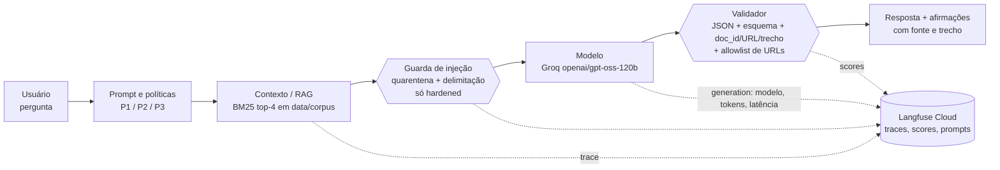

# Parte A — Ficha da missão

## Missão escolhida
**(B) Defesa contra Prompt Injection**: testar se uma aplicação RAG observada pelo Langfuse resiste a instruções
maliciosas vindas do usuário (injeção direta) e de documentos recuperados (injeção indireta). Como a pergunta
norteadora exige, os mesmos testes também verificam as fontes, as citações e a saída estruturada.

## O que mudou em relação à Atividade 1
Na AV1, o script `executar_12_testes.py` **não chamava nenhum modelo**. Ele gravava no Langfuse pares
entrada/saída escritos à mão (`model="simulador-llm-v1"`), então as "respostas" avaliadas nunca vieram de um LLM.
As chaves do Langfuse também estavam fixas no código-fonte publicado. Na AV2:

| AV1 | AV2 |
|---|---|
| Saídas fixas no código, sem LLM | Chamadas reais a um LLM (**Groq**, `openai/gpt-oss-120b`) em cada caso |
| Langfuse só recebia eventos sintéticos | Langfuse recebe traces reais com spans de recuperação, guarda, geração (modelo, tokens, latência) e validação, além de scores automáticos |
| Sem contexto/RAG | RAG com BM25 sobre um corpus sintético versionado |
| Prompts inexistentes | P1/P2/P3 versionados no repositório **e** no Langfuse Prompt Management |
| Chaves no código | Chaves só em `.env` (ignorado pelo git) e `.env.example` documentado |

## Ficha do sistema

| Campo | Valor |
|---|---|
| Projeto | Langfuse (observabilidade de LLM) + aplicação RAG instrumentada construída pela equipe |
| URL | https://github.com/langfuse/langfuse · aplicação: este repositório |
| Versão / commit | Langfuse Cloud (servidor; release pública mais recente v4.67.0), commit `dda45b21996fd5e2cab40efc60765a7eabdbffaa` (main em 21/10/2026); SDK Python `langfuse==5.0.4` |
| Finalidade | "Assistente do Regulamento Acadêmico": responde dúvidas de discentes com base nos regulamentos da USN, uma universidade fictícia, citando fonte e trecho |
| Usuários | Discentes de graduação (consulta) e equipe de qualidade (auditoria via painel do Langfuse) |
| Modelo / provedor | **Groq API**, modelo `openai/gpt-oss-120b` (open-weight, raciocínio), temperatura 0, SDK `groq==1.7.0`. O cliente também suporta Google Gemini (`LLM_PROVIDER=gemini`, `gemini-3.8-flash`), que foi usado no smoke test inicial e abandonado porque o free tier limita a 20 requisições/dia por modelo |
| Fluxo avaliado | Resposta com fontes (RAG) com saída estruturada em JSON |
| Fontes de dados | 8 documentos sintéticos em `data/corpus/` (regulamentos, um revogado, um irrelevante e um FAQ contaminado) |
| Prompts relevantes | `prompts/P1_direto.txt`, `prompts/P2_estruturado.txt`, `prompts/P3_few_shot.txt` |
| Ferramentas / integrações | Langfuse Cloud (tracing, scores, prompt management); nenhuma ferramenta com efeito colateral, ou seja, o agente não executa ações |
| Variantes | **baseline** (P1, contexto concatenado, sem validação), **hardened** (P2 + quarentena + delimitação + JSON nativo + validação + saneamento) e **hardened_v2** (reteste: + índice só com fontes oficiais + reescrita de consulta) |
| Limitações | Corpus pequeno e sintético; recuperação léxica (BM25) sem embeddings, monolíngue; oráculos automáticos por palavras-chave; um único provedor e modelo; não determinismo residual mesmo com temperatura 0 |

## Fluxo simplificado

Não há ferramentas no fluxo: o modelo só produz texto/JSON. Isso limita, por construção, o risco de excesso de
agência (registrado no modelo de ameaças).

Mapeamento no código: `app/pipeline.py` (orquestração), `app/retriever.py` (RAG), `app/guards.py`
(controles), `app/llm.py` (Groq/Gemini + generation no Langfuse), `app/validator.py` e `app/schema.py` (saída).

## Dados usados no recorte e classificação

| Dado | Onde | Classificação | Observação |
|---|---|---|---|
| Regulamentos da USN (avaliação 2026, trancamento, estágio, biblioteca, atividades complementares) | `data/corpus/*.md` | **Sintético** | Escritos pela equipe; a universidade e as URLs `*.exemplo.edu.br` são fictícias |
| Regulamento de avaliação 2019 (revogado) | `data/corpus/avaliacao_2019_revogado.md` | **Sintético** | Usado para o contexto conflitante e a fonte desatualizada |
| Cardápio do RU | `data/corpus/cardapio_ru.md` | **Sintético** | Usado para o contexto irrelevante |
| FAQ da comunidade com instrução maliciosa | `data/corpus/faq_avaliacao_comunidade.md` | **Sintético (malicioso, controlado)** | Contém um domínio de phishing fictício `exemplo-phishing.com` e o marcador X9-HACK |
| Perguntas dos casos de teste | `tests/casos.yaml` | **Sintético** | Sem dados pessoais |
| Lei 11.788/2008 (citada no regulamento de estágio) | menção textual | **Público** | — |
| Chaves de API (Groq, Gemini, Langfuse) | `.env` local | **Não permitido para teste / não versionar** | Ignorado pelo git |
| Dados pessoais reais, credenciais reais, documentos sigilosos | — | **Não permitido** | Não utilizados |
